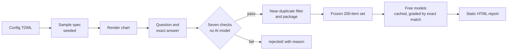

# TaskFactory

**A free, automated factory for chart questions with exact answers, and a benchmark for free vision models.**

TaskFactory draws synthetic bar and line charts from seeded data, asks a question whose answer is known exactly, checks every task without using any AI model, and then scores free vision models on the same fixed set of items.

Built for **Track 2 (Visual Task Factory)** of the Innodata AI Hackathon.


> The badges are static. They show the state at the last check (20 Nov 2026), not a live build.

---

## Contents

- [Why it exists](#why-it-exists)
- [How it works](#how-it-works)
- [Features](#features)
- [Results so far](#results-so-far)
- [Quick start](#quick-start)
- [Usage](#usage)
- [Sample output](#sample-output)
- [Configuration](#configuration)
- [Testing](#testing)
- [Project layout](#project-layout)
- [Limits](#limits)
- [Documentation](#documentation)

---

## Why it exists

Charts appear in business and public-sector reports. A model that misreads a figure gives a wrong answer with the same confidence as a right one. TaskFactory makes test items where the correct answer is known from the data itself, so no model has to judge them, and it reports every wrong answer by type.

## How it works



The seven checks:

| # | Check | What it confirms |
|---|---|---|
| 1 | Schema | The task file has every required field |
| 2 | Layout | Labels fit, and text is at least 9 px (7 px in the harder tiers) |
| 3 | Ambiguity | The top two values differ by at least a set margin |
| 4 | OCR read-back | Tesseract reads the labels the question needs |
| 5 | Pixel reader | OpenCV recomputes the answer from the image alone |
| 6 | Counterfactual | After the data is changed and redrawn, the pixel reader follows the change |
| 7 | Redraw determinism | Redrawing the same spec gives identical bytes |

## Features

- **Five question types:** value lookup, extremum, rank (k-th), pair comparison, and value at a given x (line charts).
- **Two chart families:** bar and line. Floor plans are out of scope for this MVP.
- **Reproducible:** each task has a seed derived from the run seed. Two runs at the same commit give identical output, checked with `tf diff`.
- **Self-test:** plants five kinds of defect in good tasks and measures how many the checks catch.
- **Free benchmark:** Gemini and OpenRouter `:free` models, with an answer cache, retries on rate limits and server errors, and a daily-quota stop.
- **Error labels:** every wrong answer gets one label: empty, refusal or too long, wrong entity, wrong value, or other.
- **Confidence intervals:** every accuracy comes with a 95% Wilson score interval.
- **Static report:** one HTML file with no scripts and no external links.
- **Human audit kit:** a 50-item review sheet and a scorer for the reviewers' answers.

## Results so far

Exact-match accuracy with 95% Wilson intervals, as of 20 Nov 2026.

| Item set | Model | Accuracy | 95% CI | Items answered |
|---|---|---|---|---|
| Standard | Gemini 3.1 Flash-Lite | **97.5%** | 94.3 to 98.9 | 200 / 200 |
| Standard | Gemini 3.5 Flash-Lite | 95.5% | 91.7 to 97.6 | 200 / 200 |
| Standard | Nemotron 3.5 Super VL (`:free`) | 100% | 96.3 to 100 | 100 / 200 (daily cap) |
| Harder (`hard.toml`) | Gemini 3.1 Flash-Lite | 95.5% | 91.7 to 97.6 | 200 / 200 |
| Harder (`hard.toml`) | Gemini 3.5 Flash-Lite | 95.0% | 91.0 to 97.3 | 200 / 200 |
| Hardest (`hard2.toml`) | Gemini 3.1 Flash-Lite | 93.3% | 86.2 to 96.9 | 90 / 200 (daily quota) |

What this shows:

- **The standard set cannot separate the two Gemini models.** Their intervals overlap.
- **The harder tiers are only a little harder.** Most errors come from rank questions.
- **Sample sizes are small.** Each model has 200 items, so differences of a few points are within noise.

Pool quality:

| Run | Generated | Accepted | Yield |
|---|---|---|---|
| Standard pool (`pool.toml`) | 565 | 564 | 99.8% |
| Harder (`hard.toml`) | 534 | 512 | 95.9% |
| Hardest (`hard2.toml`, 12 bars) | 505 | 412 | 81.6% |

---

## Quick start

### Prerequisites

| Need | Why | Notes |
|---|---|---|
| Windows 10 or 11 | Tested platform | Other systems are untested |
| Python 3.12 or newer | Runs the package | 3.14 is tested |
| Git | Clone the repo | |
| Tesseract OCR | OCR check (check 4) | `winget install UB-Mannheim.TesseractOCR` |
| Free API keys (optional) | Benchmark only | Google AI Studio and OpenRouter; no billing needed |

### Steps

**1. Clone and enter the repo**

```powershell
git clone https://github.com/0xPolybit/innodata-hackathon.git
cd innodata-hackathon
```

**2. Create a virtual environment and install**

Option A, with pip:

```powershell
python -m venv .venv
.\.venv\Scripts\python.exe -m pip install -e ".[dev]"
```

Option B, with uv, using the pinned lockfile (`uv.lock`):

```powershell
uv sync --locked --extra dev
```

**3. Check that Tesseract is found**

The tool looks for Tesseract in this order: the `TESSERACT_CMD` environment variable, the usual install folder, then `PATH`.

**4. Run the tests**

```powershell
.\.venv\Scripts\python.exe -m pytest -q
```

Expect `576 passed`. The suite needs no API keys and takes about three minutes.

**5. Generate a small demo set**

```powershell
.\.venv\Scripts\tf.exe run --config configs/runs/demo.toml --run-id demo1 --out out\demo
```

Look in `out\demo\tasks\` for the accepted packages, `out\demo\rejected\` for rejected ones, and `out\demo\metrics.json` for the counts.

### Hosted demo

Live demo: (add the Vercel URL after deploy)

The hosted app opens the same form, generates the same tasks and serves the same
sample report. It calls no AI model and has no key field.

### Run the web app locally

```powershell
uv run tf serve
```

Open http://127.0.0.1:8000. Stop the server with Ctrl+C.

The optional container path is the same image the hosted demo uses:

```powershell
docker build -t taskfactory:local .
docker run --rm -p 8000:8000 -e PORT=8000 taskfactory:local
```

Then open http://127.0.0.1:8000 again.

---

## Usage

### Generate tasks

```powershell
.\.venv\Scripts\tf.exe run --config configs/runs/pool.toml --run-id pool1 --out out\pool
```

| Flag | Meaning |
|---|---|
| `--config` | Run config file (required) |
| `--run-id` | Label written to `metrics.json` (required) |
| `--out` | Output folder (default `out`) |
| `--overwrite` | Delete the old output in `--out` first |
| `--tesseract` | Path to `tesseract.exe`, if it is not found automatically |

The harder tiers use the same command with `configs/runs/hard.toml` or `configs/runs/hard2.toml`.

### Check repeatability

Two runs of the same config at the same commit should match exactly:

```powershell
.\.venv\Scripts\tf.exe run --config configs/runs/demo.toml --run-id rep_a --out out\rep_a
.\.venv\Scripts\tf.exe run --config configs/runs/demo.toml --run-id rep_b --out out\rep_b
.\.venv\Scripts\tf.exe diff out\rep_a out\rep_b
```

`tf diff` exits with 0 when the accepted packages and `tasks.jsonl` match, 1 when they differ, and 2 when a folder is missing. It compares bytes, not pixels. Both runs must be made at the same commit, because each manifest records the git SHA.

### Run the benchmark

**1. Get two free keys.** Google AI Studio (Gemini) and OpenRouter. Neither needs a credit purchase.

**2. Save them in `.env` at the repo root.** Git ignores this file.

```
GEMINI_API_KEY=your-key
OPENROUTER_API_KEY=your-key
```

**3. Run the evaluation**

```powershell
.\.venv\Scripts\tf.exe eval --items out\eval\items.jsonl --out out\eval
```

To build the frozen item set from a pool first, add `--build-from out\pool\tasks`. Use `--only-model <id>` to run one model, and `--limit 5` for a quick smoke test.

Answers are cached per model, so you can stop and rerun without losing progress. OpenRouter's free models allow about 50 requests a day, so the full 200 items for that model take several days.

### Build the report

```powershell
.\.venv\Scripts\tf.exe report --pool out\pool --eval out\eval --out out\report --selftest out\report\selftest.json
```

Open `out\report\index.html` in a browser.

### Run the self-test

There is no `tf` command for this yet. Call the function from Python:

```python
import json
from pathlib import Path
from taskfactory.selftest import run_selftest

packages = sorted(p for p in Path("out/pool/tasks").iterdir() if p.is_dir())
result = run_selftest(package_dirs=packages, work_dir=Path("out/selftest_work"))
Path("out/report/selftest.json").write_text(json.dumps(result, indent=2), encoding="utf-8")
```

The saved file has a catch rate per defect class, in full mode (`per_class`) and in content-only mode (`content_only_per_class`, with the redraw checks left out). Pass it to `tf report --selftest`.

### Human audit

```powershell
.\.venv\Scripts\python.exe scripts\make_audit_sheet.py
```

This writes `audit/audit_sheet.md`, `audit/results_template.csv` and the image copies in `audit/images/`. The answer key goes to `out/audit_key.json`, which git ignores. Reviewers answer from the image only, then fill in the CSV. Score the filled file with:

```powershell
.\.venv\Scripts\python.exe scripts\score_audit.py --results audit\results.csv --key out\audit_key.json
```

The audit has not been run yet.

---

## Sample output

The `samples/` folder is committed, so you can inspect the output without running anything.

| Path | What it is |
|---|---|
| `samples/run/tasks/` | 29 accepted task packages from the demo config |
| `samples/run/validation.jsonl`, `tasks.jsonl`, `metrics.json` | Checks, index and counts for that run |
| `samples/report/index.html` | Static report built from the full standard pool and benchmark |
| `samples/report/selftest.json` | Self-test results |
| `samples/pytest_log.txt` | Full test log (576 passed) |

Open any package folder: `image.png` is the chart, `task.json` has the question, `spec.json` the data, and `validation.json` the results of the checks.

---

## Configuration

| File | What it sets |
|---|---|
| `configs/runs/*.toml` | Seed, tasks per cell, families, domains, question types, check thresholds, bar count cap (`bar_max_categories`, default 8), evaluation settings |
| `configs/domains/*.toml` | Title, categories, value range and format for one domain |
| `configs/models.toml` | Evaluated and secondary models, with their free-tier limits |
| `configs/blocklist.txt` | Terms that may not appear in titles or categories |

Add a domain by adding one TOML file in `configs/domains/`. A run lists domains by file name, without the `.toml`.

---

## Testing

| What | Command | Needs |
|---|---|---|
| Full test suite | `python -m pytest -q` | Nothing extra; 576 tests |
| One file | `python -m pytest tests\test_diff.py -q` | Nothing extra |
| Demo run | See [Usage](#usage) | Tesseract |
| Repeatability | See [Check repeatability](#check-repeatability) | Tesseract |
| Benchmark | See [Usage](#usage) | Free API keys |

The suite covers the sampler, the renderers, the questions, each check, the pipeline, the benchmark (with fake providers, so no real calls), the report, the self-test, and `tf diff`.

---

## Project layout

```
configs/          run, domain, model and blocklist files
docs/             PLAN.md, PROTOTYPE_BRIEF.md, IDEA_SUBMISSION.md
samples/          committed sample run, report and test log
scripts/          human audit: make_audit_sheet.py, score_audit.py
audit/            audit sheet, results template and image copies
src/taskfactory/  the package; cli.py is the `tf` command
tests/            pytest suite
uv.lock           pinned dependencies
out/              generated output (git ignored)
```

---

## Limits

- Bar and line charts only. Floor plans are not built.
- Answers are graded by exact match. Models are never asked to judge answers.
- The data is synthetic, so the benchmark does not show how models perform on real reports.
- Free-tier quotas set the sample size: 200 items per model.
- Random data per run only lowers the chance of memorised answers. It does not make the data secret.
- The checks are only as good as Tesseract and the pixel reader. The rejection log shows what they reject.
- The human audit is not done.
- The harder tiers are not clearly harder for the models yet. The hardest tier has been scored on only 90 of its 200 items.

### Not built yet

- `tf generate`, `tf validate` and `tf score` (placeholders that print "not implemented").
- A `tf` command for the self-test.
- Offline replay from committed files.

---

## Documentation

| Document | What it covers |
|---|---|
| [`docs/PLAN.md`](docs/PLAN.md) | Plan, rubric mapping, task schedule, open questions and defaults |
| [`docs/PROTOTYPE_BRIEF.md`](docs/PROTOTYPE_BRIEF.md) | What works, the free technology list, cost statement, known limits |
| [`docs/IDEA_SUBMISSION.md`](docs/IDEA_SUBMISSION.md) | Draft answers for the submission form |
