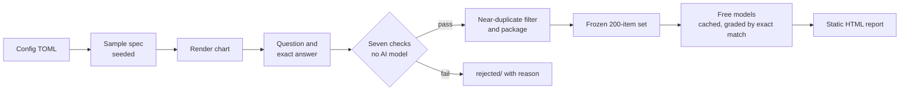

# TaskFactory

**A free, automated factory for chart questions with exact answers, and a benchmark for free vision models.**

TaskFactory draws synthetic bar and line charts from seeded data, asks a question whose answer is known exactly, checks every task without using any AI model, and then scores free vision models on the same fixed set of items.

Built for **Track 2 (Visual Task Factory)** of the Innodata AI Hackathon.


> The badges are static. They show the state at the last check (20 Nov 2026), not a live build.

---

## Contents

- [Why it exists](#why-it-exists)
- [How it works](#how-it-works)
- [Features](#features)
- [Results so far](#results-so-far)
- [Quick start](#quick-start)
- [Usage](#usage)
- [Configuration](#configuration)
- [Testing](#testing)
- [Project layout](#project-layout)
- [Limits](#limits)
- [Documentation](#documentation)

---

## Why it exists

Charts appear in business and public-sector reports. A model that misreads a figure gives a wrong answer with the same confidence as a right one. TaskFactory makes test items where the correct answer is known from the data itself, so no model has to judge them, and it reports every wrong answer by type.

## How it works



The seven checks:

| # | Check | What it confirms |
|---|---|---|
| 1 | Schema | The task file has every required field |
| 2 | Layout | Labels fit, and text is at least 9 px (7 px in the harder tier) |
| 3 | Ambiguity | The top two values differ by at least a set margin |
| 4 | OCR read-back | Tesseract reads the labels the question needs |
| 5 | Pixel reader | OpenCV recomputes the answer from the image alone |
| 6 | Counterfactual | After the data is changed and redrawn, the pixel reader follows the change |
| 7 | Redraw determinism | Redrawing the same spec gives identical bytes |

## Features

- **Five question types:** value lookup, extremum, rank (k-th), pair comparison, and value at a given x (line charts).
- **Two chart families:** bar and line. Floor plans are out of scope for this MVP.
- **Reproducible:** each task has a seed derived from the run seed, so the same config gives the same tasks.
- **Self-test:** plants five kinds of defect in good tasks and measures how many the checks catch.
- **Free benchmark:** Gemini and OpenRouter `:free` models, with an answer cache, retries on rate limits and server errors, and a daily-quota stop.
- **Error labels:** every wrong answer gets one label: empty, refusal or too long, wrong entity, wrong value, or other.
- **Static report:** one HTML file with no scripts and no external links.

## Results so far

Scores are exact-match accuracy on the frozen 200-item sets, as of 20 Nov 2026.

| Item set | Model | Accuracy | Items |
|---|---|---|---|
| Standard | Gemini 3.1 Flash-Lite | **97.5%** | 200 / 200 |
| Standard | Gemini 3.5 Flash-Lite | 95.5% | 200 / 200 |
| Standard | Nemotron 3.5 Super VL (`:free`) | 100% so far | 100 / 200 (daily cap) |
| Harder | Gemini 3.1 Flash-Lite | 95.5% | 200 / 200 |
| Harder | Gemini 3.5 Flash-Lite | 95.0% | 200 / 200 |

Pool quality: 564 of 565 generated standard tasks pass all checks. The harder tier passes 512 of 534 (yield 95.9%).

The harder tier is only a little harder. Most errors come from rank questions, not from close values.

---

## Quick start

### Prerequisites

| Need | Why | Notes |
|---|---|---|
| Windows 10 or 11 | Tested platform | Other systems are untested |
| Python 3.12 or newer | Runs the package | 3.14 is tested |
| Git | Clone the repo | |
| Tesseract OCR | OCR check (check 4) | `winget install UB-Mannheim.TesseractOCR` |
| Free API keys (optional) | Benchmark only | Google AI Studio and OpenRouter; no billing needed |

### Steps

**1. Clone and enter the repo**

```powershell
git clone https://github.com/0xPolybit/innodata-hackathon.git
cd innodata-hackathon
```

**2. Create a virtual environment and install**

```powershell
python -m venv .venv
.\.venv\Scripts\python.exe -m pip install -e ".[dev]"
```

**3. Check that Tesseract is found**

The tool looks for Tesseract in this order: the `TESSERACT_CMD` environment variable, the usual install folder, then `PATH`.

**4. Run the tests**

```powershell
.\.venv\Scripts\python.exe -m pytest -q
```

Expect `544 passed`. The suite needs no API keys and takes about two minutes.

**5. Generate a small demo set**

```powershell
.\.venv\Scripts\tf.exe run --config configs/runs/demo.toml --run-id demo1 --out out\demo
```

Look in `out\demo\tasks\` for the accepted packages, `out\demo\rejected\` for rejected ones, and `out\demo\metrics.json` for the counts.

---

## Usage

### Generate tasks

```powershell
.\.venv\Scripts\tf.exe run --config configs/runs/pool.toml --run-id pool1 --out out\pool
```

| Flag | Meaning |
|---|---|
| `--config` | Run config file (required) |
| `--run-id` | Label written to `metrics.json` (required) |
| `--out` | Output folder (default `out`) |
| `--overwrite` | Delete the old output in `--out` first |
| `--tesseract` | Path to `tesseract.exe`, if it is not found automatically |

The harder tier uses the same command with `configs/runs/hard.toml`.

### Run the benchmark

**1. Get two free keys.** Google AI Studio (Gemini) and OpenRouter. Neither needs a credit purchase.

**2. Save them in `.env` at the repo root.** Git ignores this file.

```
GEMINI_API_KEY=your-key
OPENROUTER_API_KEY=your-key
```

**3. Run the evaluation**

```powershell
.\.venv\Scripts\tf.exe eval --items out\eval\items.jsonl --out out\eval
```

To build the frozen item set from a pool first, add `--build-from out\pool\tasks`. Use `--only-model <id>` to run one model, and `--limit 5` for a quick smoke test.

Answers are cached per model, so you can stop and rerun without losing progress. OpenRouter's free models allow about 50 requests a day, so the full 200 items for that model take several days.

### Build the report

```powershell
.\.venv\Scripts\tf.exe report --pool out\pool --eval out\eval --out out\report --selftest out\report\selftest.json
```

Open `out\report\index.html` in a browser.

### Run the self-test

There is no `tf` command for this yet. Call the function from Python:

```python
import json
from pathlib import Path
from taskfactory.selftest import run_selftest

packages = sorted(p for p in Path("out/pool/tasks").iterdir() if p.is_dir())
result = run_selftest(package_dirs=packages, work_dir=Path("out/selftest_work"))
Path("out/report/selftest.json").write_text(json.dumps(result, indent=2), encoding="utf-8")
```

The saved file has a catch rate per defect class, in full mode (`per_class`) and in content-only mode (`content_only_per_class`, with the redraw checks left out). Pass it to `tf report --selftest`.

---

## Configuration

| File | What it sets |
|---|---|
| `configs/runs/*.toml` | Run seed, tasks per cell, families, domains, question types, check thresholds, evaluation settings |
| `configs/domains/*.toml` | Title, categories, value range and format for one domain |
| `configs/models.toml` | Evaluated and secondary models, with their free-tier limits |
| `configs/blocklist.txt` | Terms that may not appear in titles or categories |

Add a domain by adding one TOML file in `configs/domains/`. A run lists domains by file name, without the `.toml`.

---

## Testing

| What | Command | Needs |
|---|---|---|
| Full test suite | `python -m pytest -q` | Nothing extra; 544 tests |
| One file | `python -m pytest tests\test_checks_ocr.py -q` | Nothing extra |
| Demo run | See [Usage](#usage) | Tesseract |
| Benchmark | See [Usage](#usage) | Free API keys |

The suite covers the sampler, the renderers, the questions, each check, the pipeline, the benchmark (with fake providers, so no real calls), the report and the self-test.

---

## Project layout

```
configs/          run, domain, model and blocklist files
docs/             PLAN.md, PROTOTYPE_BRIEF.md, IDEA_SUBMISSION.md
src/taskfactory/  the package; cli.py is the `tf` command
tests/            pytest suite
out/              generated output (git ignored)
```

---

## Limits

- Bar and line charts only. Floor plans are not built.
- Answers are graded by exact match. Models are never asked to judge answers.
- The data is synthetic, so the benchmark does not show how models perform on real reports.
- Free-tier quotas set the sample size: 200 items per model.
- Random data per run only lowers the chance of memorised answers. It does not make the data secret.
- The checks are only as good as Tesseract and the pixel reader. The rejection log shows what they reject.

### Not built yet

- `tf generate`, `tf validate`, `tf score` and `tf diff` (placeholders that print "not implemented").
- A `tf` command for the self-test.
- Offline replay from committed files.

---

## Documentation

| Document | What it covers |
|---|---|
| [`docs/PLAN.md`](docs/PLAN.md) | Plan, rubric mapping, task schedule, open questions and defaults |
| [`docs/PROTOTYPE_BRIEF.md`](docs/PROTOTYPE_BRIEF.md) | What works, the free technology list, cost statement, known limits |
| [`docs/IDEA_SUBMISSION.md`](docs/IDEA_SUBMISSION.md) | Draft answers for the submission form |
