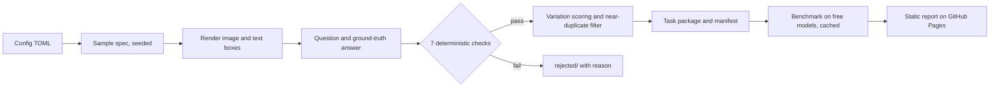

# Innodata | IDEA SUBMISSION (draft)

Status: draft, 2026-11-19. Not submitted. Track 2 (Visual Task Factory) is the recommended track; confirm before submitting. Fill the [bracketed] fields. Source: docs/PLAN.md (draft v2). Each heading below matches one field of the Google Slides template, so text can be pasted across.

---

## Team Name
[TEAM NAME]

## Problem Statement
Which visual capabilities matter most in real-world applications, and how can we reliably test whether frontier AI models possess them?

Our focus: reading charts in business and public-sector reports, and reading floor plans in building documents. Errors matter because a misread figure or room relationship can lead to a wrong decision or a wrong compliance finding, and a model's wrong answer looks just as confident as a right one.

## Team Leader Name
[TEAM LEADER NAME]

## Brief about the Idea
A reusable, automated factory that generates synthetic chart and floor-plan questions with exact reference answers. Every task is checked without any AI model. We then benchmark the best free-tier multimodal models on the same items and label each of their errors. Service cost: 0.

## Opportunity

**How different is it from existing ideas?**
Chart and visual question-answering benchmarks such as ChartQA, VQA v2 and CLEVR are finished datasets. Synthetic charts are not new on their own. What is new here is the factory: a config change produces new tasks, and the validity proof uses no model at all (two independent paths must agree, and a counterfactual re-render must follow the data).

**How will it solve the problem?**
We generate each chart or plan from seeded data, so the true answer is known exactly. Each task must pass seven deterministic checks, including a pixel reader that recomputes the answer from the image alone. Models are then scored on the same items, and every wrong answer is labelled by error type, so we can show where each model is strong and weak.

**USP**
- Validity without any model: no model judges a task or another model's answer.
- Zero cost and reproducible: free tiers and open-source tools only; offline replay from files with hashes.
- Reusable: a new domain is one configuration file, and a new image family is one renderer module.
- Fresh random data in each run reduces memorisation risk. We do not claim that leakage is impossible.

## List of features
- One command runs the factory from a config file (`tf run --config`), with stable per-task seeds.
- Three renderers (bar, line, floor plan), three domains, and six question types with exact answers.
- Seven deterministic validation checks, plus a self-test that plants known defects and reports how many are caught.
- Variation metrics and near-duplicate removal.
- A benchmark runner for three free models, with caching and resume.
- A static HTML report: validation funnel, variation, accuracy by model and question type, error analysis, and annotated failures.

## Process flow diagram



Use cases:

| Actor | Uses the factory to |
|---|---|
| Evaluator | Generate tasks, run the benchmark, read the report |
| Judge or reviewer | Replay a run offline and open any task package |
| Developer | Add a domain (config) or a family (renderer module) |

## Wireframe (report page, optional)

```
+-------------------------------------------------------+
| Run [id]  ·  service cost 0  ·  manifests verified    |
+-------------------------------------------------------+
| Funnel: generated [n]  >  passed [n]  >  yield [%]     |
| Self-test catch rate by defect class                  |
| Human audit: error rate [%] with 95% CI               |
+-------------------------------------------------------+
| Accuracy heatmap: model x question type               |
| Error labels by family and structural knob            |
| Annotated failures: image, question, answer, error    |
+-------------------------------------------------------+
```

## Architecture diagram

```
configs/*.toml ──► taskfactory (Python, `tf` CLI)
                    ├─ sampler and renderers: matplotlib, Pillow, numpy
                    ├─ validators, no model: schema, layout, Tesseract OCR,
                    │    OpenCV pixel reader, counterfactual re-render
                    ├─ llm.py ──► Gemini free tier (Google AI Studio)
                    │            OpenRouter :free models
                    │            Ollama, local (Gemma 3 4B, secondary check only)
                    └─ storage: out/<run>/tasks/... + JSONL + manifest.json
                                    │
                                    ▼
                         static HTML report ──► GitHub Pages
```

## Technologies to be used
Python 3.12 or newer; matplotlib, Pillow, numpy, OpenCV, pytest; Tesseract OCR; Google AI Studio free tier (Gemini API, no billing); OpenRouter `:free` models (no credit purchase); Ollama with Gemma 3 4B (local); plain files and JSONL storage; static HTML on GitHub Pages; Mermaid or draw.io for diagrams; OBS Studio for the video; Google Slides for the deck.

## Estimated implementation cost
Service cost: 0. No billing information is needed and no paid tier is used. Hardware: our own laptops. Effort: about 8 to 10 working days for two people (plan, section 3). Free-tier limits set the evaluation size: about 200 items per model.

## Add as per the requirements of the hackathon

| Deliverable | Where it lives |
|---|---|
| Runnable source code | Package `taskfactory`, `pyproject.toml`, lockfile, `tf` CLI |
| Sample task packages | `out/sample/tasks/` (one sample run, about 30 packages), committed |
| Validation test logs | `out/sample/validation.jsonl`, pytest log, validator self-test report |
| Technical documentation | README quickstart, `docs/PLAN.md`, documented config files |
| Live working prototype demo | Offline replay from cached files; report on GitHub Pages |

---

## Open items before submitting (not for the slides)
- Confirm Track 2, or switch to Track 1 at the 25 Nov decision gate.
- Fill in the team name and team leader name.
- Confirm with the organisers that code-rendered images are accepted.
- Replace the template's pre-filled technology and cost text. It names the Claude Code API, multimodal LLM APIs and organiser-provided Claude Code subscriptions, none of which fit the free-only rule.
- Remove the template's claim that the approach "prevents test data leakage". We can say only that random data per run reduces memorisation risk.
